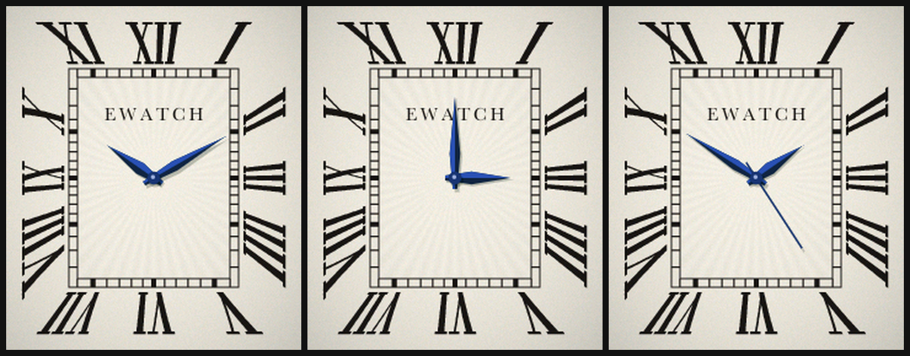

# TankFace

Stand-alone EWatch v2 firmware: a rectangular Tank-style dress-watch dial that
fills the 240x280 screen.



- Radial Roman numerals with their feet to the centre (IIII at four), a
  chemin-de-fer minute track inside them, a silvered ground with a faint
  sunray in the centre, blued sword hands with a lit and a shaded facet.
- Signed `EWATCH` under XII (`SIGNATURE` in `tools/build_dial.py`). It is a
  homage to the Cartier Tank dial, not a copy of the wordmark: this repo is
  public.
- No seconds hand by default, as on the original. **Tap** or a **short button
  press** toggles a thin sweeping seconds hand. Hold the button 2 s to power
  off.
- Time from the RV-3028 RTC (set it with EWatchOS). No hands = RTC not read.

The dial is baked into flash as RGB565 (134 KB, `src/dial_data.h`); only the
hands are drawn on the watch, anti-aliased, straight into the framebuffer.
Numerals and ticks sit at true hour/minute angles from the screen centre, so
on the rectangular track the ticks bunch up towards the corners and a hand
always points at its own mark.

## Build / flash
```bash
pio run -t upload && pio device monitor
```
The monitor prints `time= rtc= seconds= fps= draw= flush=` every 5 s.
Coming from EWatchOS, keep the button held while it uploads: EWatchOS does not
pad-hold the power latch, so the flasher's reset switches the watch off.
Same partition table as EWatchOS2.1 (`huge_app.csv`), so going back is a plain
upload from that project.

## Redraw the dial
```bash
uv run --with pillow --with numpy tools/build_dial.py
```
All the geometry, colours and the signature are constants at the top. The
signature is set in Baskerville from macOS (falls back to Times).

## Host checks (no watch needed)
```bash
test/render.sh
```
Renders 96 times across 24 h with the firmware's own drawing code and measures
from the pixels where both hands point; checks that all 60 minute ticks sit on
their minute rays; writes PNGs to `test/out/`. Every checker is first run
against broken input (hour hand ignoring minutes, no hands, angles half a
minute off) to prove it can fail.

## Files
- `src/main.cpp` hardware, RTC, input, frame loop
- `src/tank_draw.*` dial copy + hands (host-testable, no display library)
- `src/dial_data.h` generated, do not edit
- `tools/build_dial.py` draws the dial
- `test/` host harness and checkers
